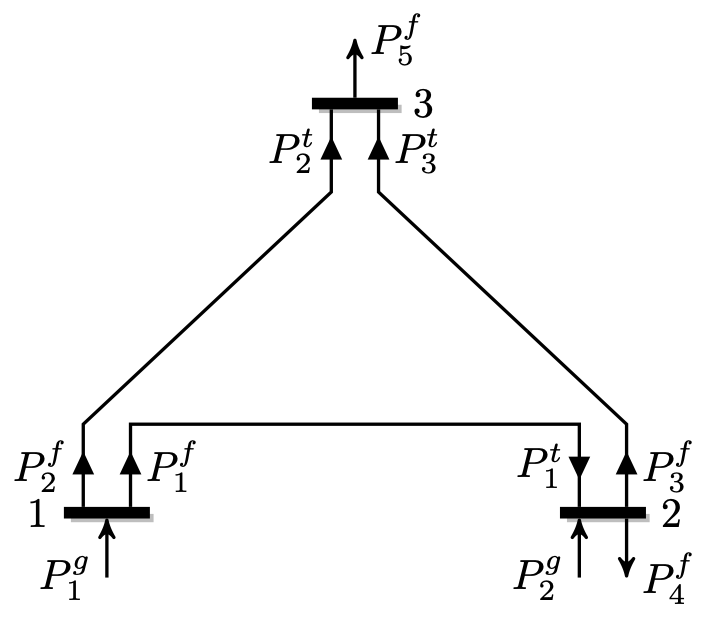

# Active Power Flow Components (APFC) and Reactive Power Flow Components (RPFC)

MATLAB implementation of matrix-based power flow contribution methods.

## Overview

This package provides efficient matrix-based algorithms for decomposing active and reactive power flows in power networks into contributions from individual generators and reactive sources. The methods use a proportional-sharing principle and can handle complex topologies including meshed networks, transformers with tap ratios, and circulating power flows.

**Key Features:**

- **APFC (Active Power Flow Components)**: Allocates active power flows to generators
- **RPFC (Reactive Power Flow Components)**: Allocates reactive power flows to generators and reactive sources
- **Matrix Formulation**: Efficient computation of all generator contributions via a single LU factorization
- **Branch-Level Resolution**: Separates from-end and to-end contributions for every branch
- **Shunt Handling**: Correctly attributes line-charging capacitances and bus-mounted capacitor banks
- **Circulating Flow Support**: Handles reactive circulating flows via Neumann-series convergence analysis

## Requirements

- **MATLAB** (R2018b or later)
- **MATPOWER** (tested with version 7.0+)

### Installation

1. Install MATPOWER:

   ```matlab
   % Add MATPOWER to MATLAB path
   addpath('/path/to/matpower7.x');
   ```

2. Ensure this code folder is in your MATLAB path:

   ```matlab
   addpath('/path/to/code');
   ```

## File Structure

### Core Functions

- **`apfc.m`**: Main function for APFC computation
  - Input: MATPOWER case file or case name
  - Output: APFC contribution table and modified case structure
  - Constructs demand-as-branches model with virtual sink bus
  - Builds system matrix and solves for all generator contributions

- **`rpfc.m`**: Main function for RPFC computation
  - Input: MATPOWER case file or case name
  - Output: RPFC contribution table and modified case structure
  - Classifies branches into three reactive cases based on flow signs
  - Computes series and shunt flow components
  - Handles circulating reactive flows via cycle product verification

- **`batch_solve.m`**: Batch processing script
  - Runs both APFC and RPFC on multiple test cases
  - Generates CSV output files for verification

### Test Cases (`cases/` directory)

Standard MATPOWER test networks:

- **`case1.m`**: Three-bus system (verification example)
- **`case9.m`**: IEEE 9-bus system (radial/meshed topology)
- **`case14.m`**: IEEE 14-bus system (small network)
- **`case30.m`**: IEEE 30-bus system (transformers and capacitor banks)
- **`case33.m`**: IEEE 33-bus system (distribution network)
- **`case118.m`**: IEEE 118-bus system (large transmission network)
- **`tap_loop.m`**: Parallel transformers with circulating reactive flow example

### Results

- **`paper_results/`**: Reference results from the paper
  - Format: `case{N}_{apfc|rpfc}.csv`
  - Contains contribution matrices for validation

- **`results/`**: Output directory for computed results
  - Generated by running `batch_solve.m`
  - Format matches reference results for comparison

## Usage

### Basic Usage

#### Compute APFC for a single case

```matlab
[APFC_tbl, mpc] = apfc('cases/case1');
```

#### Compute RPFC for a single case

```matlab
[RPFC_tbl, mpc] = rpfc('cases/case1');
```

#### Run batch computation

```matlab
batch_solve;
```

### Output Format

Both functions return tables with:

- **Rows**: Network elements (branches with labels, loads, demands)
- **Columns**: Generator/source contributions
- **Values**: Power contributions (MW for APFC, Mvar for RPFC)
- **Row sums**: Match solved power flows (verification check)

### Detailed Example

```matlab
% Add paths
addpath('/path/to/matpower7.x');
addpath(pwd);

% Run APFC
[APFC_tbl, mpc] = apfc('cases/case9');
disp('APFC Table:');
disp(APFC_tbl);

% Run RPFC
[RPFC_tbl, mpc] = rpfc('cases/case9');
disp('RPFC Table:');
disp(RPFC_tbl);

% Export to CSV
writetable(APFC_tbl, 'case9_apfc_custom.csv');
writetable(RPFC_tbl, 'case9_rpfc_custom.csv');
```

## Key Results from Test Cases

### Case 1 (Three-Bus System)

This verification case is the three-bus system used in the paper's worked
example. It demonstrates the demand-as-branches construction, the virtual sink
bus used by APFC, and the reactive preprocessing used by RPFC.



Active power flows, attenuation factors, and inflow weights:

| ℓ   | from |  to | P<sup>f</sup><sub>ℓ</sub> | P<sup>t</sup><sub>ℓ</sub> | a<sup>P</sup><sub>ℓ</sub> |
| --- | ---: | --: | ------------------------: | ------------------------: | ------------------------: |
| 1   |    1 |   2 |                    38.608 |                    36.545 |                    0.9466 |
| 2   |    1 |   3 |                    46.119 |                    43.506 |                    0.9434 |
| 3   |    2 |   3 |                     6.545 |                     6.494 |                    0.9921 |
| 4   |    2 |   - |                        50 |                        50 |                         1 |
| 5   |    3 |   - |                        50 |                        50 |                         1 |

Reactive power flows and branch classification:

| ℓ   | from |  to | Q<sup>f</sup><sub>ℓ</sub> | Q<sup>t</sup><sub>ℓ</sub> | Q<sup>sf</sup><sub>ℓ</sub> | Q<sup>st</sup><sub>ℓ</sub> | Q<sup>s</sup><sub>ℓ</sub> | Q<sup>e</sup><sub>ℓ</sub> | Case |
| --- | ---: | --: | ------------------------: | ------------------------: | -------------------------: | -------------------------: | ------------------------: | ------------------------: | ---: |
| 1   |    1 |   2 |                    26.148 |                    22.378 |                      1.832 |                      1.430 |                    27.980 |                    20.949 |    1 |
| 2   |    1 |   3 |                    25.595 |                    19.945 |                      1.832 |                      1.422 |                    27.427 |                    18.523 |    1 |
| 3   |    2 |   3 |                    -2.622 |                     0.055 |                      1.430 |                      1.422 |                    -1.192 |                    -1.367 |    3 |

APFC result (MW):

| Row                         | G<sub>1</sub> | G<sub>2</sub> |  Total |
| --------------------------- | ------------: | ------------: | -----: |
| D<sub>2</sub>               |        32.315 |        17.685 |     50 |
| D<sub>3</sub>               |        47.703 |         2.297 |     50 |
| ℓ<sub>1-2</sub><sup>f</sup> |        38.608 |             0 | 38.608 |
| ℓ<sub>1-3</sub><sup>f</sup> |        46.119 |             0 | 46.119 |
| ℓ<sub>2-3</sub><sup>f</sup> |         4.230 |         2.315 |  6.545 |
| ℓ<sub>1-2</sub><sup>t</sup> |        36.545 |             0 | 36.545 |
| ℓ<sub>1-3</sub><sup>t</sup> |        43.506 |             0 | 43.506 |
| ℓ<sub>2-3</sub><sup>t</sup> |         4.197 |         2.297 |  6.494 |

RPFC result (Mvar):

| Row                         | G<sub>1</sub> | ℓ<sub>2-3</sub><sup>f</sup> | ℓ<sub>2-3</sub><sup>t</sup> | ℓ<sub>1-2</sub><sup>s</sup> | ℓ<sub>1-3</sub><sup>s</sup> |  Total |
| --------------------------- | ------------: | --------------------------: | --------------------------: | --------------------------: | --------------------------: | -----: |
| D<sub>2</sub>               |        15.662 |                       2.097 |                           0 |                       2.241 |                           0 |     20 |
| D<sub>3</sub>               |        17.286 |                           0 |                       0.055 |                           0 |                       2.659 |     20 |
| G<sub>2</sub>               |         3.915 |                       0.524 |                           0 |                       0.560 |                           0 |      5 |
| ℓ<sub>1-2</sub><sup>f</sup> |        26.148 |                           0 |                           0 |                           0 |                           0 | 26.148 |
| ℓ<sub>1-3</sub><sup>f</sup> |        25.595 |                           0 |                           0 |                           0 |                           0 | 25.595 |
| ℓ<sub>1-2</sub><sup>t</sup> |        19.577 |                           0 |                           0 |                       2.801 |                           0 | 22.378 |
| ℓ<sub>1-3</sub><sup>t</sup> |        17.286 |                           0 |                           0 |                           0 |                       2.659 | 19.945 |
| ℓ<sub>2-3</sub><sup>f</sup> |             0 |                      -2.622 |                           0 |                           0 |                           0 | -2.622 |
| ℓ<sub>2-3</sub><sup>t</sup> |             0 |                           0 |                       0.055 |                           0 |                           0 |  0.055 |

### Case 9 (IEEE 9-Bus)

- Illustrates meshed topology with multi-source loads
- Demonstrates line-charging dominance in reactive supply
- Reference: Generators supply residual reactive balance

### Case 30 (IEEE 30-Bus)

- Tests transformers with tap-ratio attribution
- Validates capacitor bank contributions
- Verifies from-end to-end reactive losses

### Case 118 (IEEE 118-Bus)

- Large network with 54 generators and 186 branches
- Tests computational efficiency: single LU factorization for all sources
- Demonstrates advantage over iterative algorithms

### Tap Loop (Circulating Flows)

- Parallel transformers with tap mismatch ($\tau_A = 1.05$, $\tau_B = 0.95$)
- Validates cycle product condition ($\gamma \approx 0.877 < 1$)
- Shows correct handling of reactive circulation

## Validation

The methods are validated by verifying that **row sums of contribution matrices match solved power flows**:

```
Row Sum Check: Σ_s Contribution_ℓ,s = Total_Flow_ℓ (within numerical precision)
```

This verification is performed for:

- Active power at every from-end and to-end (APFC)
- Reactive power at every from-end and to-end (RPFC)
- All test cases from 3-bus to 118-bus networks

## Notes on Branch Classification

### Active Power (APFC)

- All branches carry positive power (after orientation normalization)
- Demand branches connect loads to virtual sink bus

### Reactive Power (RPFC)

Branch classification (before preprocessing):

- **Case 1**: $Q_f > 0$, $Q_t > 0$ → normal carrier
- **Case 2**: $Q_f > 0$, $Q_t < 0$ → split into demand at both ends
- **Case 3**: $Q_f < 0$, $Q_t > 0$ → removed as pure source

Negative shunts (inductive elements) are converted to auxiliary demand branches.

## Related Work

- [Todorovski, M. and Rajičić, D., "Decomposing total power flows into contributions originating from power sources in loads, generators, and network elements," _Electric Power Systems Research_, 2024.](https://doi.org/10.1016/j.epsr.2024.110433)
- [Enshaee, A. and Enshaee, P., "New reactive power flow tracing and loss allocation algorithms for power grids using matrix calculation," _International Journal of Electrical Power & Energy Systems_, 2017.](https://doi.org/10.1016/j.ijepes.2016.11.010)
- [Gutierrez, A., et al., "Power Flow Tracing in Power Systems with Active and Reactive Circulating Power Flows," _Electric Power Components and Systems_, 2023.](https://doi.org/10.1080/15325008.2023.2175928)
- [Achayuthakan, C., Dent, C.J., Bialek, J.W., and Ongsakul, W., "Electricity Tracing in Systems With and Without Circulating Flows: Physical Insights and Mathematical Proofs," _IEEE Transactions on Power Systems_, vol. 25, no. 2, pp. 1078–1087, May 2010.](https://doi.org/10.1109/TPWRS.2009.2037506)

## License

This project is licensed under the MIT License. See the LICENSE file for details.
